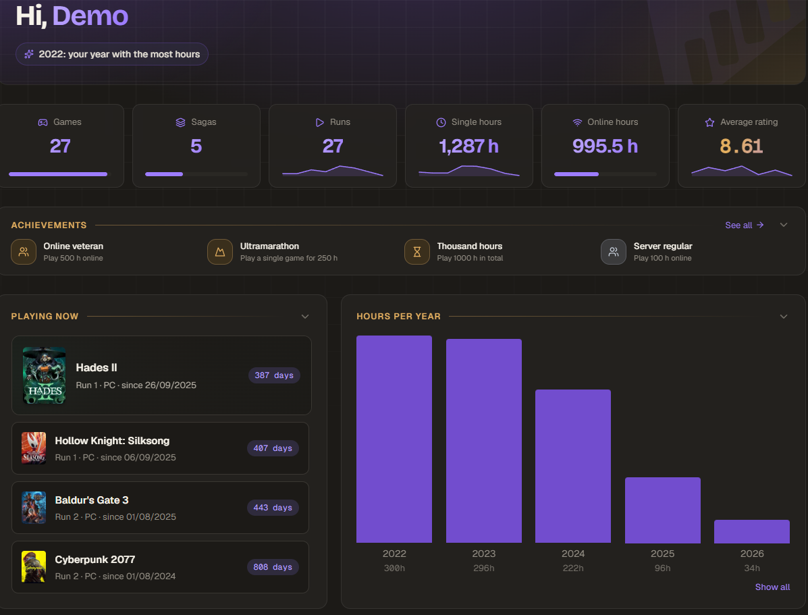
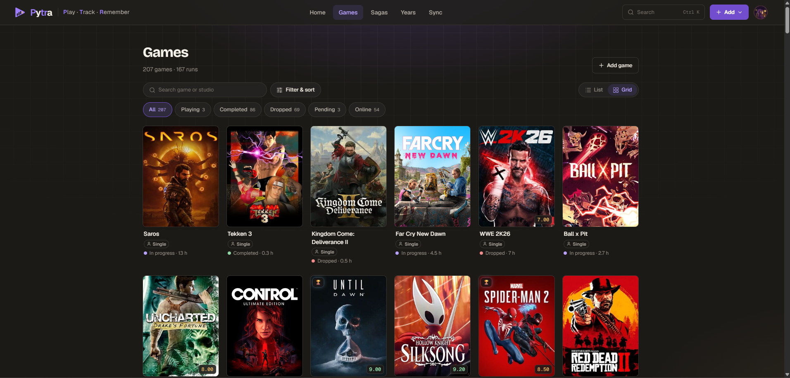
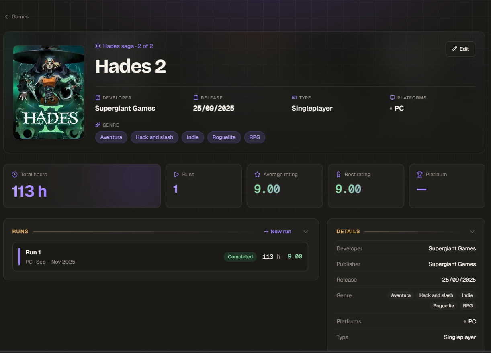
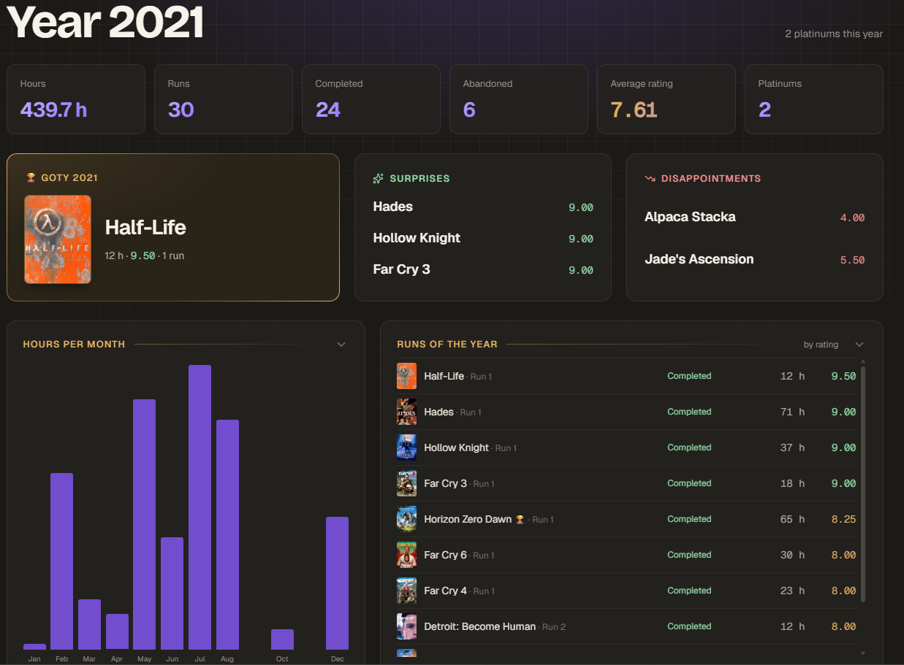

# Pytra Web

Frontend for **Pytra** ("Play, Track, Remember"), a personal video game tracker. One Angular codebase ships as a web SPA (installable as a PWA) and as an Android app (Capacitor).

| | |
|---|---|
| Live app | https://pytra.up.railway.app |
| API | https://pytra-api-production.up.railway.app |
| Backend repo | [EstebanMM13/pytra-api](https://github.com/EstebanMM13/pytra-api) (Spring Boot) |

## Screenshots

<table>
  <tr>
    <td width="50%"><br><sub><b>Dashboard</b>: totals, achievements, games in progress and hours per year</sub></td>
    <td width="50%"><br><sub><b>Library</b>: cover grid with status filters, search and list/grid views</sub></td>
  </tr>
  <tr>
    <td width="50%"><br><sub><b>Game detail</b>: metadata, saga, hours, ratings, platinum and runs</sub></td>
    <td width="50%"><br><sub><b>Years</b>: year in review with GOTY, surprises, disappointments and hours per month</sub></td>
  </tr>
</table>

## Quick start

```bash
npm ci
npm start          # ng serve on http://localhost:4200
```

> The dev server talks to a **local API** on `http://localhost:8080` (run [pytra-api](https://github.com/EstebanMM13/pytra-api) locally). Production builds use the Railway API. See [Configuration](#configuration).

## Features

| Area | What you can do |
|---|---|
| Auth | Register, mandatory email verification (with resend), login with username or email, forgot/reset password, Google login |
| Demo | Read-only demo session from the login screen; write actions are hidden or blocked |
| Dashboard | Stats summary, achievements, games in progress, hours per year, top-rated runs, most-played singleplayer and online games |
| Library | Games with cover, saga, genres, developer/publisher and release date; status filters, search, sorting, list and grid views |
| Runs | Log, edit and delete runs (experiences) per game: platform, dates, hours, status, rating, platinum. Online playtime for `ONLINE`/`HYBRID` games |
| Sagas | Group games into sagas and see progress per saga |
| Years | Year in review: totals, GOTY, surprises, disappointments, hours per month, the year's runs and a free-text note |
| Achievements | Badges derived from your library and stats (hours, completed runs, sagas, online time...) |
| Global search | Jump to any game from anywhere (`Ctrl K`) |
| Sync | Link **Steam** and **PlayStation** (by online ID) and sync the library. Unmatched games land in a pending queue; each one is confirmed with the full game form (or ignored). The API fills pending games from IGDB in the background |
| IGDB autofill | Search IGDB (or the Steam store) from the game form to prefill name, cover, developer, publisher, release date and genres |
| Profile | Avatar, username, data export (CSV / Markdown), account deletion |
| Preferences | Theme (dark / light / system), language (Spanish / English), rating precision (integers, halves or two decimals), default platform, animations (system / full / reduced) |

## Tech stack

| Area | Choice |
|---|---|
| Framework | Angular 22.2: standalone components, signals, lazy-loaded routes, service worker |
| Language | TypeScript 6.0 |
| Styling | Tailwind CSS 4 (via PostCSS) |
| i18n | @ngx-translate/core 18, `public/i18n/es.json` and `en.json` (Spanish by default) |
| Mobile | Capacitor 8.5 (Android): `app`, `browser`, `filesystem`, `share` |
| Tests | Vitest 5 + jsdom (through `ng test`) |
| Serving | nginx 1.27 (Docker), Node 24 build stage |

## Project structure

```
src/app/
├── core/                 # Cross-cutting, no UI
│   ├── api-base-url.ts   # API origin (read from src/environments)
│   ├── guards/           # authGuard, guestGuard
│   ├── interceptors/     # Adds the JWT to API requests
│   ├── models/           # API DTO types
│   ├── services/         # One service per API resource, auth, UserDataCache, preferences, theme, demo mode, native OAuth
│   └── validators/       # Username rules (mirror the API)
├── features/             # Routed pages
│   ├── auth/             # login, register, verify-email, forgot/reset-password, oauth-callback
│   ├── dashboard/
│   ├── games/            # library, game detail, game form (with IGDB autofill), run form and detail
│   ├── sagas/
│   ├── years/
│   ├── sync/             # steam/, psn/, shared/ (pending review)
│   └── profile/
└── shared/               # navbar, global-search, achievements, toast, splash, ui/ (design system), utils/, pipes/
```

## How it works

**Caching.** `core/services/user-data-cache.ts` caches the per-user lists and stats several screens share (games, sagas, stats, Steam and PSN pending) with **stale-while-revalidate** reads: a cached value renders at once, then a background refresh emits only if the data changed. Values are tagged with the session token, so they never leak across logout, another login or the demo. Any write invalidates everything.

**Motion.** `shared/utils/motion.ts` applies the animations preference to `<html data-motion>` before bootstrap. `system` follows `prefers-reduced-motion`, `full` always animates, `reduce` turns effects off. Script-driven effects (count-up, parallax, tilt, confetti, splash) check `canAnimate` and render the final state when motion is off.

## Scripts

| Command | Purpose |
|---|---|
| `npm start` | Dev server (`ng serve`) |
| `npm run build` | Production build to `dist/pytra-web/browser` (plus font preloads via `scripts/preload-fonts.mjs`) |
| `npm run watch` | Development build in watch mode |
| `npm test` | Unit tests (`ng test`, Vitest on jsdom) |

**Bundle budget:** the initial bundle warns above **420 kB** and fails above 500 kB (`angular.json`). Keep heavy features in lazy routes.

**CI:** `.github/workflows/ci.yml` runs `npm ci`, `npm run build` and `ng test --watch=false` on Node 24 for every push and pull request to `master`.

## Configuration

| Setting | Where | Value |
|---|---|---|
| API origin (development) | `src/environments/environment.ts` | `http://localhost:8080` |
| API origin (production) | `src/environments/environment.production.ts` | `https://pytra-api-production.up.railway.app` |
| API in CSP | `nginx.conf.template` (`connect-src`) | Same origin as production |
| App id / deep-link scheme | `capacitor.config.ts`, `android/app/build.gradle`, `AndroidManifest.xml` | `com.estebanmm13.pytra` |
| OAuth deep link | `AndroidManifest.xml`, `core/services/native-oauth.service.ts` | `com.estebanmm13.pytra://oauth-callback` |

`src/app/core/api-base-url.ts` exports `API_ORIGIN` / `API_BASE_URL` from the active environment file. The `production` build configuration (the default for `ng build` / `npm run build`) swaps `environment.ts` for `environment.production.ts` through `fileReplacements` in `angular.json`, so:

| Command | Configuration | API origin |
|---|---|---|
| `npm start` (`ng serve`) | development | `http://localhost:8080` |
| `ng build --configuration development`, `npm run watch` | development | `http://localhost:8080` |
| `npm run build`, Docker image | production | Railway |
| Android app (`npm run build` + `npx cap sync android`) | production | Railway |

The API's default CORS and `FRONTEND_URL` already allow `http://localhost:4200`. If you change the production origin, update `connect-src` in `nginx.conf.template` too (nginx only serves production builds).

The JWT is stored in `localStorage` and sent by the auth interceptor. Preferences are stored locally per device.

## Build for production (Docker + nginx)

The `Dockerfile` builds the app with Node 24 and serves `dist/pytra-web/browser` with nginx, listening on `$PORT` (default `8080`).

```bash
docker build -t pytra-web .
docker run -p 8080:8080 pytra-web
```

`nginx.conf.template` provides:

- **SPA fallback:** unknown routes serve `index.html` (`Cache-Control: no-cache`).
- **Long caching** for content-hashed `.js`/`.css` (`1y`, `immutable`).
- **Security headers** on every response: `Content-Security-Policy` (`script-src 'self'`, `frame-ancestors 'none'`, API-only `connect-src`), `X-Content-Type-Options`, `Referrer-Policy`, `X-Frame-Options: DENY`, `Permissions-Policy`.
- gzip for text assets.

Critical CSS inlining is disabled in `angular.json` so the build emits no inline scripts and the strict `script-src` holds.

## Android app (APK)

Requirements: Android SDK (min SDK 24, target SDK 36) and a JDK for Gradle.

```bash
npm run build                 # 1. production web build
npx cap sync android          # 2. copy it into the Android project
cd android && ./gradlew assembleDebug                    # 3. build the APK
adb install -r app/build/outputs/apk/debug/app-debug.apk # 4. install / update on the device
```

> The APK **bundles the web build**. After any web change, repeat all four steps; otherwise the app keeps running the old code.

**How login works on Android:** Google rejects OAuth in embedded WebViews, so Google login and Steam linking open in a Custom Tab with `client=android`. The API finishes by redirecting to `com.estebanmm13.pytra://oauth-callback?code=...`; the app catches that deep link, closes the tab and routes to `/oauth-callback`, which exchanges the one-time code for a JWT. On the web, the same flows use a normal full-page redirect.

The Android WebView origin is `https://localhost`, which the API allows in CORS by default.

## Deployment (Railway)

The web app runs as the `pytra-web` service on Railway, built from the `Dockerfile`. There is no GitHub auto-deploy; deploy manually from this directory:

```bash
railway up --service pytra-web --environment production --detach
```

## Known limitations

- **Debug APK only:** there is no release signing configuration.
